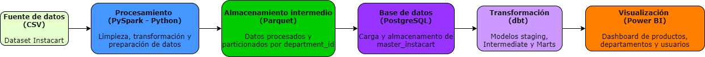
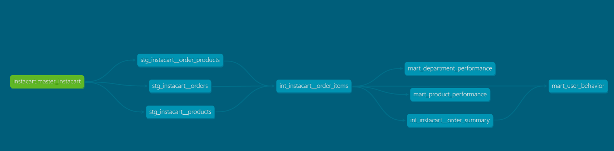
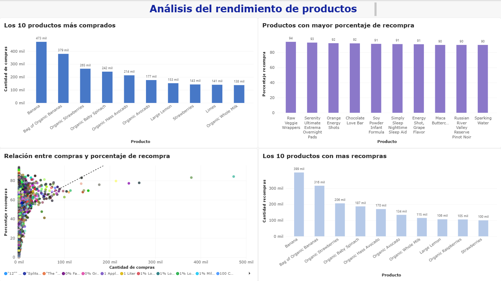
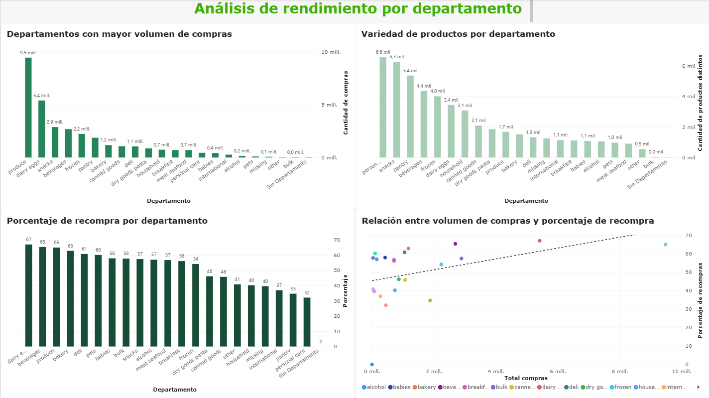
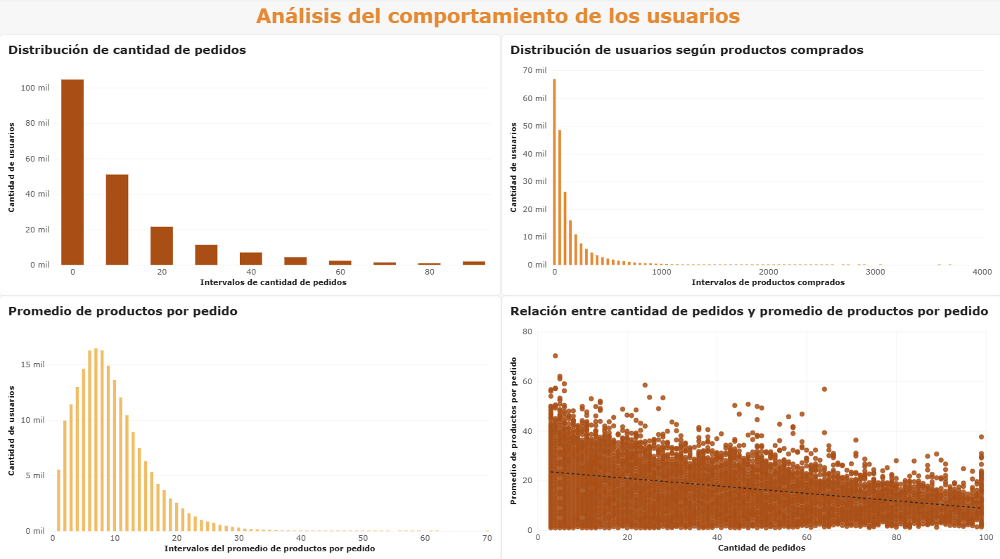

# 🛒 Instacart Big Data Pipeline

Proyecto de ingeniería de datos enfocado en el procesamiento y análisis de información de la plataforma Instacart, una plataforma de comercio electrónico de productos de supermercado. El dataset contiene información relacionada con usuarios, pedidos, productos y departamentos, permitiendo estudiar distintos aspectos del comportamiento de compra.

El objetivo del proyecto es construir un pipeline de datos que permita realizar procesos de extracción, limpieza, transformación y almacenamiento de grandes volúmenes de información, con el propósito de obtener datos estructurados y confiables para su análisis.

Finalmente, se busca generar información analítica que permita identificar patrones de compra, analizar el rendimiento de productos y departamentos, estudiar el comportamiento de los usuarios y facilitar la toma de decisiones mediante dashboards interactivos.

## 🎯 Objetivos del proyecto

### 🎯 Objetivo general

Desarrollar un pipeline de ingeniería de datos de principio a fin, que permita procesar, transformar, almacenar y analizar grandes volúmenes de información de Instacart, generando datos estructurados y confiables que faciliten la identificación de patrones de compra y apoyen la toma de decisiones mediante visualizaciones interactivas.

### 📌 Objetivos específicos

- Limpiar y preparar los datasets originales, identificando y gestionando posibles inconsistencias y problemas de calidad de datos.
- Desarrollar procesos de procesamiento de datos utilizando PySpark, incorporando transformaciones y almacenamiento en formato Parquet particionado por departamento.
- Implementar la carga de los datos procesados en PostgreSQL, permitiendo su almacenamiento, consulta y validación.
- Utilizar dbt para desarrollar modelos de transformación y organización de datos, creando tablas analíticas mediante las capas Staging, Intermediate y Marts.
- Validar la calidad e integridad de los datos mediante pruebas y consultas SQL, verificando la consistencia de los resultados.
- Construir dashboards interactivos en Power BI para analizar el comportamiento de los usuarios, el rendimiento de los productos y las métricas por departamento.

## 🧰 Tecnologías utilizadas

Las siguientes herramientas y tecnologías fueron utilizadas para desarrollar el pipeline de datos:

| Tecnología       | Uso en el proyecto                                                                                                                         |
| ---------------- | ------------------------------------------------------------------------------------------------------------------------------------------ |
| **Python**       | Lenguaje de programación utilizado para desarrollar los procesos de procesamiento y manipulación de datos.                                 |
| **Apache Spark** | Motor de procesamiento distribuido utilizado para trabajar con grandes volúmenes de datos.                                                 |
| **PySpark**      | API de Python utilizada para implementar las operaciones de procesamiento y transformación mediante Apache Spark.                          |
| **Parquet**      | Formato de almacenamiento columnar utilizado para guardar los datos procesados.                                                            |
| **PostgreSQL**   | Sistema gestor de bases de datos relacional utilizado para almacenar los datos y permitir consultas SQL.                                   |
| **dbt**          | Herramienta de transformación y modelado de datos utilizada para construir modelos SQL organizados en capas Staging, Intermediate y Marts. |
| **SQL**          | Lenguaje utilizado para realizar consultas, transformaciones y validaciones de datos.                                                      |
| **Power BI**     | Herramienta de visualización utilizada para construir dashboards interactivos y analizar los resultados.                                   |
| **WSL (Ubuntu)** | Entorno Linux utilizado para ejecutar los procesos y herramientas del proyecto desde Windows.                                              |


## 🏗️ Arquitectura del proyecto

El proyecto comienza con la obtención del dataset público de Instacart, compuesto por archivos CSV que contienen información sobre usuarios, pedidos, productos y departamentos.

Posteriormente, mediante PySpark se realiza el procesamiento de los datos, incluyendo tareas de limpieza, transformación y preparación. Los resultados se almacenan en formato Parquet, utilizando particionamiento por `department_id`.

A continuación, los datos procesados se cargan en PostgreSQL mediante un script desarrollado en Python, donde se almacenan en la tabla principal `master_instacart`.

Sobre esta información se utiliza dbt para desarrollar modelos de transformación organizados en las capas Staging, Intermediate y Marts. Estas transformaciones permiten estructurar los datos y generar tablas analíticas reutilizables.

Finalmente, Power BI se conecta a PostgreSQL para consumir las tablas Marts generadas por dbt, permitiendo construir dashboards interactivos orientados al análisis de productos, departamentos y comportamiento de los usuarios.

### 🖼️ Diagrama de arquitectura



## 📁 Estructura del proyecto

El repositorio se encuentra organizado en diferentes carpetas, separando los datos originales, los archivos procesados, el código fuente, las transformaciones y la documentación.

```text
instacart-big-data-pipeline/
│
├── data/
│   ├── raw/                         # Archivos CSV originales de Instacart
│   └── processed/                   # Datos procesados en formato Parquet
│
├── docs/
│   ├── images/                      # Capturas de los dashboards y otras imágenes
│   └── VALIDACION_Y_CALIDAD.md      # Documentación de validaciones
│
├── instacart_dbt/
│   ├── models/
│   │   ├── staging/                 # Modelos de preparación de datos
│   │   ├── intermediate/            # Modelos intermedios
│   │   └── marts/                   # Modelos analíticos finales
│   ├── dbt_project.yml              # Configuración principal de dbt
│   └── .gitignore                   # Exclusiones específicas de dbt
│
├── powerbi/
│   └── instacart_analisis.pbix       # Dashboard de análisis en Power BI
│
├── src/
│   ├── pyspark/
│   │   ├── explore_instacart.py     # Exploración, procesamiento ETL y agregaciones
│   │   └── validate_parquet.py      # Validación de los archivos Parquet
│   └── load_parquet_to_postgres.py  # Carga de Parquet a PostgreSQL
│
├── .gitignore                      # Archivos y carpetas excluidos de Git
├── README.md                       # Documentación principal del proyecto
└── requirements.txt                # Dependencias de Python
```

### 🗂️ Descripción de las carpetas y archivos

- **data/:** contiene los archivos originales de Instacart en `raw/` y los datos procesados y particionados en formato Parquet dentro de `processed/`.

- **docs/:** almacena la documentación del proyecto, incluyendo el diagrama de arquitectura y el documento de validación y calidad de datos.

- **instacart_dbt/:** contiene el proyecto dbt, sus modelos de transformación organizados en las capas Staging, Intermediate y Marts, además de sus configuraciones y pruebas.

- **powerbi/:** contiene los archivos de Power BI (.pbix), donde se desarrollaron los dashboards para analizar el rendimiento de los productos, los departamentos y el comportamiento de los usuarios.

- **src/:** contiene los scripts desarrollados en Python y PySpark para explorar, procesar, validar y cargar los datos en PostgreSQL.

- **venv-linux/:** entorno virtual de Python utilizado durante el desarrollo y ejecución del proyecto. No se incluye en el repositorio de GitHub.

- **requirements.txt:** contiene las dependencias necesarias para instalar las bibliotecas de Python utilizadas en el proyecto.

- **.gitignore:** define los archivos y carpetas que Git debe excluir del seguimiento y publicación en el repositorio.

- **README.md:** documento principal que presenta el proyecto, sus objetivos, arquitectura, tecnologías utilizadas y procedimientos de ejecución.


## 🔄 Flujo de procesamiento de datos

### 📥 1. Lectura de los datos originales

El proceso comienza con la lectura de los archivos CSV del dataset público de Instacart. Se utilizan los datos relacionados con pedidos, productos, departamentos y pasillos, incluyendo `order_products__prior` como fuente de información sobre los productos asociados a los pedidos.

### ⚙️ 2. Procesamiento y transformación con PySpark

Mediante PySpark se realizan distintas operaciones para preparar y estructurar la información:

- Auditoría inicial para identificar valores nulos en columnas clave de los diferentes conjuntos de datos.
- Conversión de tipos de datos, transformando columnas que inicialmente eran de tipo `string` a tipos numéricos como `integer`, cuando correspondía.
- Unión de distintos conjuntos de datos mediante operaciones `JOIN`, permitiendo enriquecer la información y relacionar pedidos, usuarios, productos y departamentos.
- Preparación de un DataFrame principal que reúne la información necesaria para los análisis posteriores.

### 🗃️ 3. Almacenamiento en formato Parquet

Una vez finalizado el procesamiento, el DataFrame principal se almacena en formato Parquet.

Se seleccionó este formato por su almacenamiento columnar y su eficiencia para trabajar con grandes volúmenes de datos.

Además, se implementó particionamiento por `department_id`, organizando los archivos Parquet según el departamento. Esto permite acceder de manera más eficiente a los datos cuando las consultas utilizan filtros por departamento.

### 🐘 4. Carga en PostgreSQL

Posteriormente, los archivos Parquet generados se leen mediante un script desarrollado en Python para cargar la información en PostgreSQL.

El resultado es la tabla principal `master_instacart`, que centraliza los datos procesados y sirve como fuente para las transformaciones posteriores realizadas con dbt.


## 🧱 Transformaciones y modelos analíticos con dbt

dbt cumple un papel fundamental dentro del proyecto, ya que permite organizar, transformar y validar los datos mediante modelos SQL. Su utilización facilita la construcción de transformaciones reutilizables y la organización de los datos en distintas capas, preparando la información para su análisis.

### 🧩 Capas de transformación

El proyecto utiliza tres capas principales:

- **Staging:** se encarga de preparar y estandarizar los datos de origen, mediante la selección de columnas, conversiones de tipos de datos y limpieza básica.
- **Intermediate:** contiene las transformaciones intermedias, como la unión de tablas mediante `JOIN`, la combinación de información y la preparación de los datos para los modelos finales.
- **Marts:** corresponde a la capa analítica final, donde se generan tablas estructuradas con métricas específicas para facilitar las consultas y su posterior visualización en Power BI.

### 🔗 Dependencias entre modelos



### 📊 Modelos analíticos (Marts)

A partir de las transformaciones realizadas con dbt se construyeron tres tablas analíticas:

- **`mart_product_performance`:** contiene métricas relacionadas con el rendimiento de los productos, como la cantidad de compras, cantidad de recompras y porcentaje de recompra.
- **`mart_department_performance`:** presenta métricas agrupadas por departamento, incluyendo el total de compras, cantidad de productos distintos y porcentaje de recompra.
- **`mart_user_behavior`:** reúne información sobre el comportamiento de los usuarios, considerando la cantidad de pedidos, productos comprados, productos recomprados y promedio de productos por pedido.

Estas tablas permiten disponer de información organizada y específica para analizar el comportamiento de compra desde tres perspectivas: productos, departamentos y usuarios.

## ✅ Validación y calidad de datos

Se realizaron validaciones mediante consultas SQL y pruebas de calidad con dbt para comprobar la integridad, consistencia y confiabilidad de los datos procesados.

Se ejecutaron satisfactoriamente 20 pruebas de dbt, verificando condiciones como unicidad y ausencia de valores nulos en los campos correspondientes.

También se comprobó que las métricas de los modelos analíticos coincidieran con los registros de la tabla principal y que Power BI pudiera consumir correctamente la información almacenada en PostgreSQL.

Para conocer los resultados detallados de las validaciones, las pruebas realizadas y las mediciones de rendimiento, consultar el documento [Validación y calidad de datos](docs/VALIDACION_Y_CALIDAD.md).


## ⚡ Rendimiento y optimización

Durante el desarrollo del proyecto se tomaron decisiones orientadas a mejorar la organización de los datos y facilitar su consulta, especialmente considerando el volumen de información procesado.

### 🗃️ Almacenamiento en formato Parquet

Se utilizó Parquet como formato de almacenamiento para los datos procesados con PySpark, debido a su estructura columnar, que permite realizar lecturas selectivas de columnas y trabajar de manera eficiente con grandes volúmenes de información.

### 🧭 Particionamiento por departamento

Se implementó particionamiento mediante `department_id`, utilizando la función `partitionBy()` de PySpark.

Esta decisión permitió organizar los datos en particiones independientes y facilitar la lectura selectiva cuando se necesitan consultar departamentos específicos.

Además, Spark puede aplicar la optimización Partition Pruning, evitando leer particiones que no son necesarias para determinadas consultas.

### ⏱️ Medición del rendimiento en PostgreSQL

Se realizaron pruebas mediante `EXPLAIN ANALYZE` para evaluar los tiempos de ejecución de consultas sobre los modelos analíticos.

Los resultados mostraron tiempos de respuesta bajos en las tablas evaluadas. La medición de la tabla principal quedó pendiente debido a una limitación durante la ejecución de la prueba.

Para consultar los tiempos obtenidos y los detalles de esta limitación, revisar el documento [Validación y calidad de datos](docs/VALIDACION_Y_CALIDAD.md).

## 📊 Visualización de resultados con Power BI

Para facilitar el análisis de los datos procesados, se desarrollaron tres dashboards interactivos en Power BI, conectados directamente a PostgreSQL y alimentados por los modelos analíticos generados mediante dbt.

El objetivo de estas visualizaciones fue obtener información relevante sobre el comportamiento de compra, identificar patrones y analizar el rendimiento de productos y departamentos.

En conjunto, los tres dashboards permiten analizar la información desde distintas perspectivas, facilitando la identificación de productos populares, departamentos con mayor actividad y patrones de comportamiento de los usuarios.

### 🛍️ Dashboard de productos

Este dashboard permite analizar el rendimiento individual de los productos mediante diferentes métricas:

- Identificación de los 10 productos con mayor cantidad de compras.
- Identificación de los productos con mayor porcentaje de recompra.
- Análisis de los 10 productos con mayor cantidad de recompras.
- Relación entre la cantidad de compras y el porcentaje de recompra.

#### 🖼️ Vista del dashboard



#### 🔎 Principales resultados

Producto más comprado: Banana registró la mayor cantidad de compras, con un total de 472.565.

Mayor porcentaje de recompra: Raw Veggie Wrappers alcanzó un 94,12%, seguido de Serenity Ultimate Extrema Overnight Pads, con un 93%.

Relación entre compras y recompra: el gráfico de dispersión muestra una tendencia ascendente. Los productos con mayor volumen de compras se sitúan consistentemente en niveles elevados de porcentaje de recompra, mientras que los productos con menor volumen presentan una mayor dispersión y variabilidad en su tasa de recompra.


### 🏬 Dashboard de departamentos

Este dashboard permite comparar el rendimiento de los distintos departamentos:

- Identificación de los departamentos con mayor cantidad de compras.
- Análisis de la variedad de productos por departamento.
- Comparación de la cantidad y porcentaje de recompras.
- Relación entre el volumen de compras y el porcentaje de recompra.

#### 🖼️ Vista del dashboard



#### 🔎 Principales resultados

Departamento con mayor cantidad de compras: Produce registró un total de 9.479.291 compras.

Mayor variedad de productos: Personal Care presentó la mayor cantidad de productos distintos, con 6.563.

Relación entre compras y recompra: se observa una ligera tendencia ascendente. Los departamentos con mayor volumen de compras (como Produce) tienden a registrar porcentajes de recompra competitivos y elevados (en torno al 65%), esto sugiere que los departamentos con mayor volumen de compras tambien pueden presentar porcentajes de recompra elevados.

### 👥 Dashboard de usuarios

Este dashboard está orientado al análisis del comportamiento de compra de los usuarios:

- Distribución de usuarios según la cantidad de pedidos realizados.
- Distribución de usuarios según la cantidad de productos comprados.
- Análisis del promedio de productos por pedido.
- Relación entre la cantidad de pedidos realizados y el promedio de productos por pedido.

#### 🖼️ Vista del dashboard



#### 🔎 Principales resultados

Cantidad de pedidos: el intervalo de 0 a 10 pedidos concentra la mayor cantidad de usuarios, con 104.513. A medida que aumenta la cantidad de pedidos, la cantidad de usuarios generalmente disminuye, aunque se observa un ligero incremento en el intervalo de 90 a 100 pedidos respecto al intervalo anterior.

Cantidad de productos comprados: se observa una disminución progresiva de usuarios a medida que aumenta la cantidad de productos comprados.

Pedidos y promedio de productos: el gráfico de dispersión muestra una tendencia descendente. Los usuarios más recurrentes (con mayor cantidad de pedidos) tienden a mantener un promedio más moderado y constante de productos por pedido, mientras que aquellos con pocos pedidos presentan una dispersión mucho más amplia, alcanzando los promedios más altos de productos por compra.


## 🚀 Instalación y ejecución del proyecto

Esta sección describe los requisitos y pasos necesarios para configurar el entorno y ejecutar el pipeline de datos de Instacart.

### 📋 1. Requisitos previos

Para ejecutar el proyecto se necesitan las siguientes herramientas:

- **Python:** para desarrollar y ejecutar los scripts de procesamiento.
- **Apache Spark y PySpark:** para realizar la limpieza y transformación de los datos.
- **Java:** entorno de ejecución necesario para Apache Spark, utilizando una versión compatible.
- **PostgreSQL:** para almacenar los datos procesados y los modelos analíticos.
- **dbt Core y dbt-postgres:** para ejecutar las transformaciones SQL y generar los modelos analíticos.
- **Git:** para clonar y gestionar el repositorio.
- **WSL con Ubuntu:** entorno Linux utilizado durante el desarrollo del proyecto.
- **Power BI Desktop:** herramienta opcional para visualizar y analizar los dashboards.

### 📥 2. Clonar el repositorio

Descargar el proyecto desde GitHub mediante:

```bash
git clone <URL_DEL_REPOSITORIO>
cd instacard-big-data-pipeline
```

### 🐍 3. Configurar el entorno de Python

Crear y activar un entorno virtual:

```bash
python3 -m venv venv-linux
source venv-linux/bin/activate
```

Instalar las dependencias del proyecto:

```bash
pip install -r requirements.txt
```

### 🐘 4. Preparar PostgreSQL

Antes de ejecutar el proceso de carga, es necesario contar con PostgreSQL instalado y en funcionamiento.

Crear la base de datos `instacart` y configurar un usuario llamado `instacart_user` con los permisos necesarios para crear y modificar tablas.

El script de carga utiliza los siguientes parámetros de conexión:

- **Host:** `localhost`
- **Puerto:** `5432`
- **Base de datos:** `instacart`
- **Usuario:** `instacart_user`

La contraseña se solicita directamente durante la ejecución del script, por lo que no es necesario escribirla dentro del código.

### 📂 5. Preparar los datos

Descargar el dataset público de Instacart y colocar los archivos CSV originales dentro de la carpeta:

```text
data/raw/
```

Los archivos deben conservar sus nombres y estructura para que los scripts puedan identificarlos correctamente.

### ⚙️ 6. Ejecutar el procesamiento con PySpark

Con el entorno virtual activado, ejecutar el script encargado del procesamiento de los datos:

```bash
python src/pyspark/explore_instacart.py
```

Este proceso realiza la limpieza, transformación y preparación de los datos, generando los archivos Parquet particionados por `department_id`.

### 📤 7. Cargar los datos en PostgreSQL

Una vez generados los archivos Parquet, ejecutar el script encargado de cargar los datos procesados en PostgreSQL:

```bash
python src/load_parquet_to_postgres.py
```

El script lee los archivos Parquet por lotes de 100.000 registros y utiliza el comando `COPY` de PostgreSQL para realizar una carga masiva de datos.

La información se almacena en la tabla principal `master_instacart`, que se crea automáticamente si no existe.

**Importante:** antes de realizar la carga, el script ejecuta `TRUNCATE TABLE` sobre `master_instacart`. Por lo tanto, si se vuelve a ejecutar, los registros existentes se eliminan y se reemplazan por los nuevos datos.

### 🧱 8. Ejecutar los modelos de dbt

Ingresar a la carpeta del proyecto dbt:

```bash
cd instacart_dbt
```

Configurar previamente la conexión con PostgreSQL en el perfil de dbt (`profiles.yml`), ubicado normalmente en `~/.dbt/`.

Luego ejecutar los siguientes comandos:

```bash
dbt debug
dbt run
dbt test
```

Estos comandos permiten comprobar la conexión, ejecutar los modelos de transformación y realizar las pruebas de calidad de datos.

### 📈 9. Visualizar los resultados

Los dashboards desarrollados se encuentran dentro de la carpeta `powerbi/`:

- `instacart_analisis.pbix`

Abrir el archivo correspondiente mediante Power BI Desktop y configurar la conexión con PostgreSQL para acceder a las tablas analíticas generadas por dbt:

- `mart_product_performance`
- `mart_department_performance`
- `mart_user_behavior`

Una vez establecida la conexión, se pueden consultar y actualizar los dashboards para analizar los resultados del proyecto.

**Nota:** Los datos originales, archivos procesados, entornos virtuales y credenciales de conexión no se incluyen en el repositorio. Deben prepararse localmente antes de ejecutar el pipeline. Los archivos `.pbix` contienen las visualizaciones, pero para actualizar los datos es necesario tener PostgreSQL configurado y ejecutar previamente el pipeline.


## 📝 Conclusiones

El desarrollo de este proyecto permitió adquirir experiencia práctica en ingeniería de datos, trabajando con grandes volúmenes de información y utilizando distintas herramientas para construir un pipeline de procesamiento y análisis de datos de principio a fin.

Durante su implementación fue posible comprender la importancia de la limpieza, transformación y organización de los datos. Además, se adquirieron conocimientos prácticos sobre el uso de PySpark para procesar grandes cantidades de información y aplicar técnicas de particionamiento mediante Parquet, facilitando el almacenamiento y acceso a los datos.

También se profundizaron los conocimientos sobre el almacenamiento y consulta de información mediante PostgreSQL, la transformación y modelado de datos con dbt y la construcción de dashboards interactivos utilizando Power BI. Asimismo, se realizaron distintas validaciones mediante consultas SQL y pruebas de dbt, permitiendo comprobar la integridad y consistencia de los datos procesados.

Uno de los principales desafíos fue comprender la estructura y organización del proyecto, especialmente la distribución de los modelos, carpetas y scripts de procesamiento. También se presentaron dificultades relacionadas con el rendimiento durante el procesamiento de grandes volúmenes de información y la configuración de las conexiones entre PostgreSQL y Power BI.

Como posibles mejoras futuras, se plantea profundizar el análisis de los datos e incorporar modelos predictivos que permitan anticipar patrones de compra, estimar comportamientos de los usuarios e identificar tendencias de consumo. Además, se podría mejorar la automatización y optimización del pipeline para facilitar su ejecución y mantenimiento.

En conclusión, el proyecto permitió integrar diferentes tecnologías de ingeniería y análisis de datos, desarrollando un pipeline completo que transforma información original en datos estructurados, modelos analíticos y visualizaciones interactivas que facilitan la identificación de patrones de compra y apoyan la toma de decisiones.